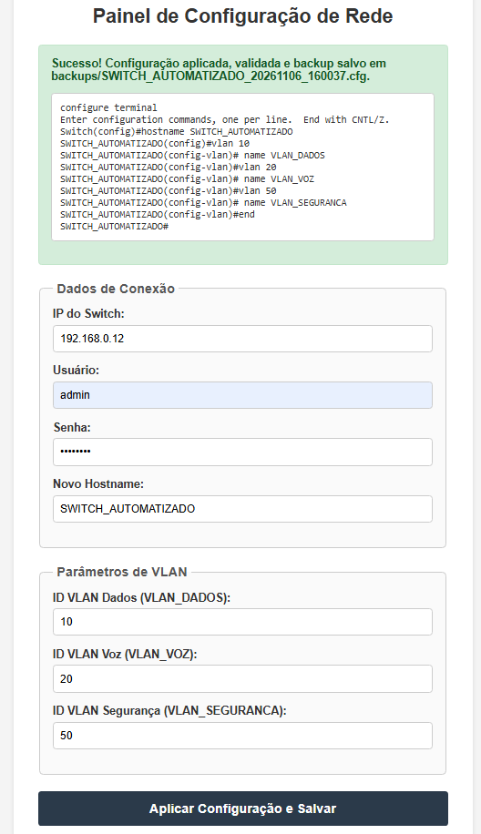
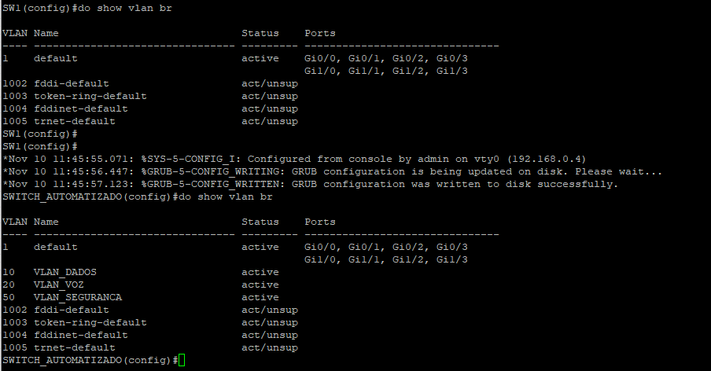
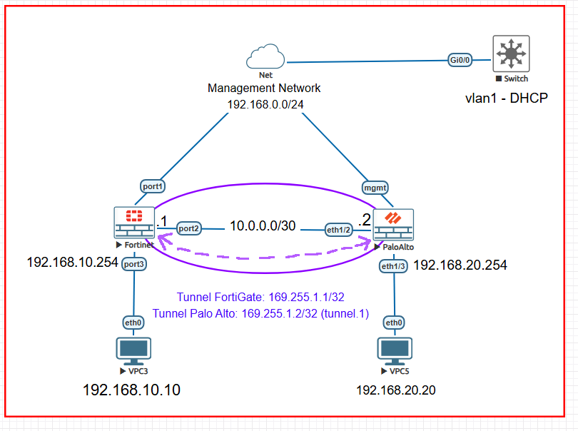
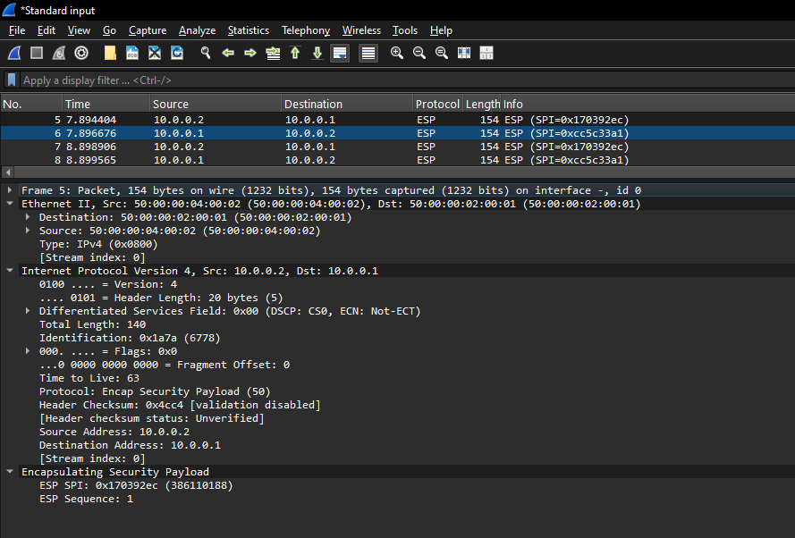
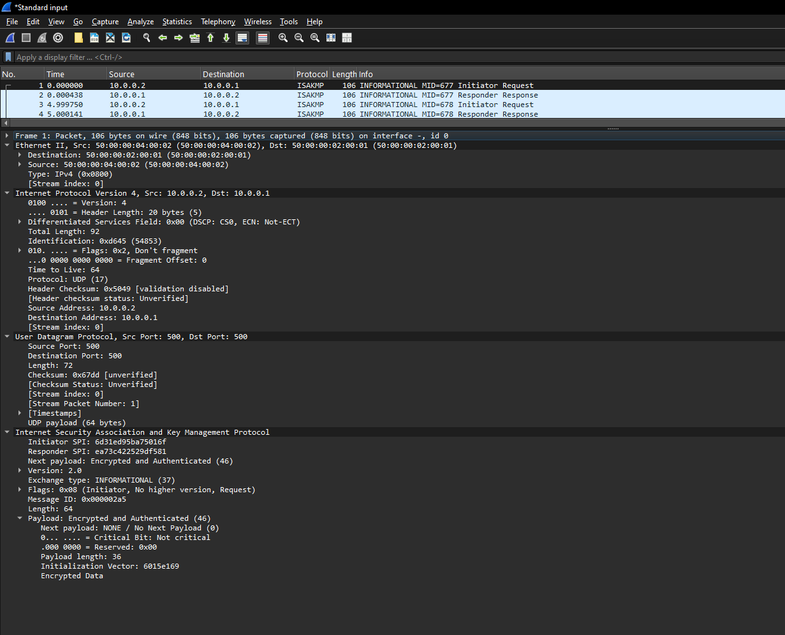

# Automação de Redes | Desafio Técnico de Networking

Projeto de laboratório desenvolvido em Python para automatizar configurações em equipamentos Cisco IOS, FortiGate e Palo Alto Networks. O repositório reúne duas frentes: configuração de switch via SSH e implementação de VPN site-to-site IPSec entre firewalls de fabricantes diferentes.

> **Escopo:** ambiente de laboratório EVE-NG. Os endereços, algoritmos e políticas apresentados não constituem uma recomendação para produção.

## Tecnologias

- **Python:** lógica de automação, validações e integração com equipamentos.
- **Flask + Netmiko:** interface web e configuração de switch Cisco IOS por SSH.
- **FortiOS 7.6.2:** automação por REST API/CMDB.
- **PAN-OS 10.1.0:** automação por XML API e commit de configuração.
- **EVE-NG:** ambiente de simulação e testes de conectividade.

## Parte 1: automação de switch Cisco IOS

A aplicação `app.py` disponibiliza uma interface web para informar os dados de acesso do switch e aplicar configurações de hostname e VLANs. A rotina salva a configuração, produz backup local e consulta o equipamento para verificar hostname, IDs, nomes e estado das VLANs.

Configuração padrão documentada: VLAN 10 (`VLAN_DADOS`), VLAN 20 (`VLAN_VOZ`) e VLAN 50 (`VLAN_SEGURANCA`). A aplicação trata entradas inválidas, erros de autenticação e falhas de conexão. Testes locais estão em `tests/test_app.py`.

### Executar a aplicação Cisco

```powershell
python -m venv .venv
.venv\Scripts\Activate.ps1
pip install -r requirements.txt
python app.py
```

Abra `http://127.0.0.1:5000` no computador onde o Flask está em execução. A aplicação altera a configuração do equipamento informado: use apenas dispositivos autorizados para o laboratório.

Para executar os testes locais:

```powershell
python -m unittest discover -s tests -v
```

## Evidências parte 1

### Cisco IOS






## Parte 2: VPN IPSec FortiGate e Palo Alto

A segunda parte automatiza a criação de uma VPN **route-based**, com IKEv2, entre um FortiGate e um Palo Alto. Os scripts criam objetos de VPN, interfaces de túnel, rotas e políticas de segurança conforme os recursos de cada plataforma.

### Topologia do laboratório



A topologia mostra a conexão WAN direta entre os firewalls (`10.0.0.0/30`), as duas LANs e as interfaces lógicas da VPN. A nuvem `Net` representa a rede de gerenciamento do laboratório; o switch à direita está conectado a essa rede e não faz parte do caminho de dados IPSec. Os endereços dos túneis são `169.255.1.1/32` no FortiGate e `169.255.1.2/32` (`tunnel.1`) no Palo Alto.

| Parâmetro | FortiGate | Palo Alto |
| --- | --- | --- |
| Sistema | FortiOS 7.6.2 | PAN-OS 10.1.0 |
| LAN | `192.168.10.0/24` | `192.168.20.0/24` |
| WAN | `10.0.0.1/30` | `10.0.0.2/30` |
| IKE | IKEv2, DES/SHA256, DH14 | IKEv2, DES/SHA256, DH14 |
| IKE lifetime | 28800 s | 28800 s |
| ESP | DES/SHA256, PFS DH14 | DES/SHA256, PFS DH14 |
| IPSec lifetime | 3600 s | 3600 s |

**Nota de segurança:** DES é obsoleto e inseguro. Foi utilizado exclusivamente para reproduzir os parâmetros do laboratório. Em produção, devem ser adotados algoritmos modernos e políticas restritivas.

### Plano de automação exigido pelo desafio

O planejamento detalhado, incluindo sequência de implementação, diferenças entre fabricantes, validação e alertas, está em **[docs/PLANO_AUTOMACAO_VPN.md](docs/PLANO_AUTOMACAO_VPN.md)**. A implementação funcional foi realizada como extensão do escopo obrigatório de planejamento.

### Scripts e APIs

**FortiGate:** `fortigate_rest_76/fortigate_vpn_etapas_corrigido.py` utiliza a API REST para configurar as etapas da VPN. Disponibiliza modos `preview`, `inventory` e `apply`, além de seleção de etapa por `--step`.

**Palo Alto:** `paloalto_panos101_api/paloalto_vpn.py` utiliza a XML API para criar perfis IKE/IPSec, gateway, túnel, zona, associações de interface, rota, objetos de endereço e políticas. Os modos são `preview`, `apply`, `validate` e `commit`. O arquivo `paloalto_vpn_revisado.py` contém melhorias em análise para comparação de configuração e acompanhamento do commit; não deve ser tratado como validado em equipamento sem testes adicionais.

### Preparação do ambiente

Instale as dependências da aplicação Cisco e dos dois módulos de VPN:

```powershell
pip install -r requirements.txt
pip install -r fortigate_rest_76/requirements.txt
pip install -r paloalto_panos101_api/requirements.txt
```

Copie `.env.example` para `.env` e preencha os valores localmente. Copie também cada `config.example.json` para `config.json` na pasta correspondente (os `config.json` são locais e ignorados pelo Git). Configure as variáveis de ambiente em um `.env` local, não versionado. Os scripts utilizam, conforme o módulo, `FG_HOST`, `FG_API_TOKEN`, `PAN_API_KEY` e `VPN_PSK`. Consulte os exemplos e a implementação de cada módulo antes de executar. Mantenha os arquivos `config.json` sem credenciais.

### Execução FortiGate

Execute a partir da raiz do repositório:

```powershell
python fortigate_rest_76/fortigate_vpn_etapas_corrigido.py --config fortigate_rest_76/config.json --mode preview
python fortigate_rest_76/fortigate_vpn_etapas_corrigido.py --config fortigate_rest_76/config.json --mode inventory
```

Após revisar a configuração e realizar backup completo do equipamento, o modo `apply` exige `--step`. Exemplo para a etapa `phase1` (altera o equipamento):

```powershell
python fortigate_rest_76/fortigate_vpn_etapas_corrigido.py --config fortigate_rest_76/config.json --mode apply --step phase1 --confirm
```

### Execução Palo Alto

```powershell
python paloalto_panos101_api/paloalto_vpn.py --config paloalto_panos101_api/config.json --mode preview
python paloalto_panos101_api/paloalto_vpn.py --config paloalto_panos101_api/config.json --mode validate
```

Para um ambiente ainda não configurado, o modo `apply` altera a **candidate configuration**. A ativação depende de um commit separado:

```powershell
python paloalto_panos101_api/paloalto_vpn.py --config paloalto_panos101_api/config.json --mode apply --confirm
python paloalto_panos101_api/paloalto_vpn.py --config paloalto_panos101_api/config.json --mode commit --confirm
```

**Cuidado:** um commit pode incluir outras alterações pendentes na configuração candidata. Revise as diferenças antes de executar. A versão original do script apenas solicita o commit; a confirmação do job deve ser consultada no PAN-OS.

## Validação e resultados obtidos

A VPN foi estabelecida no laboratório e verificada nos dois firewalls:

- No Palo Alto, o job de validação e o commit terminaram com `FIN / OK`.
- O comando `show vpn ike-sa` apresentou IKEv2 em estado `Established`.
- O comando `show vpn ipsec-sa` apresentou uma SA ESP/DES/SHA256 ativa.
- No FortiGate, `diagnose vpn tunnel list name VPN-ML` apresentou `status=up`, `sa=1` e DPD `ok`.
- Foram realizados pings entre as redes `192.168.10.0/24` e `192.168.20.0/24`.
- Após os testes, os contadores do FortiGate passaram de zero para `dec:pkts/bytes=10/840` e `enc:pkts/bytes=10/1400`, comprovando tráfego processado pela SA IPSec nos dois sentidos.

Comandos úteis para repetir a verificação:

**Palo Alto, modo operacional (`>`):**

```text
show jobs all
show vpn ike-sa
show vpn ipsec-sa
show vpn flow
```

**FortiGate:**

```text
get vpn ipsec tunnel summary
diagnose vpn tunnel list name VPN-ML
```

As evidências Cisco estão em `images/parte1/` e as evidências VPN em `images/parte2/`. A topologia está em `images/topologia.PNG`. As capturas Wireshark mostram IKEv2 (UDP/500) e ESP (IP protocolo 50); os contadores do FortiGate confirmam pacotes criptografados e descriptografados.

## Estrutura do repositório

```text
.
├── app.py
├── templates/
│   └── index.html
├── fortigate_rest_76/
│   ├── fortigate_vpn_etapas_corrigido.py
│   ├── config.example.json
│   └── README.md
├── paloalto_panos101_api/
│   ├── paloalto_vpn.py
│   ├── paloalto_vpn_revisado.py
│   ├── config.example.json
│   └── README.md
├── tests/
├── images/
│   ├── topologia.PNG
│   ├── parte1/
│   └── parte2/
├── requirements.txt
└── README.md
```

## Segurança e limitações

- Nunca publique `.env`, tokens, chaves de API, PSK, backups completos de firewall, `.venv` ou arquivos sensíveis de laboratório.
- O `.gitignore` não remove arquivos já rastreados nem apaga segredos do histórico Git. Verifique o histórico antes da publicação e revogue credenciais expostas.
- O script Palo Alto original verifica principalmente a existência de objetos; isso não equivale à validação completa dos valores.
- As alterações de configuração não são transacionais e podem deixar uma configuração candidata parcialmente modificada em caso de falha.
- A versão revisada do Palo Alto e as melhorias de idempotência precisam de testes adicionais antes de serem declaradas concluídas.
- Não há comprovação, neste README, de testes automatizados completos de integração ou de rollback automático.

## Status

**Validado em laboratório:** configuração da VPN, commit Palo Alto, estabelecimento IKEv2/IPSec e tráfego criptografado bidirecional.

**Em revisão:** robustez dos scripts, idempotência, testes automatizados adicionais e documentação técnica detalhada por fabricante.

**Atenção ao requisito da Parte 1:** o enunciado usa o nome `VLAN_SEGURANÇA`, enquanto o código atual configura `VLAN_SEGURANCA` (sem cedilha). Essa diferença deve ser resolvida ou justificada antes da entrega. Os READMEs técnicos descrevem os scripts usados no laboratório e distinguem a versão revisada ainda não validada.

## Evidências parte 2

### VPN IPSec






Outras capturas de validação e de tratamento de erros estão nas pastas `images/parte1/` e `images/parte2/`.
