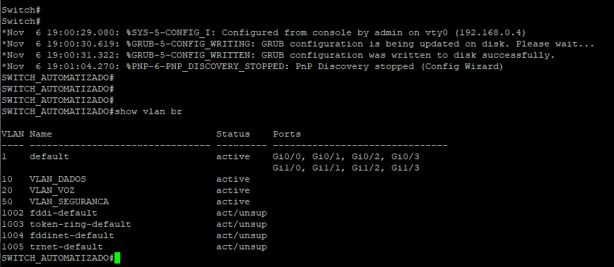

# Automação de Redes | Desafio Técnico de Networking

Projeto de laboratório desenvolvido em Python para automatizar configurações em equipamentos Cisco IOS, FortiGate e Palo Alto Networks. O repositório reúne duas frentes: configuração de switch via SSH e implementação de VPN site-to-site IPSec entre firewalls de fabricantes diferentes.

> **Escopo:** ambiente de laboratório EVE-NG. Os endereços, algoritmos e políticas apresentados não constituem uma recomendação para produção.

## Tecnologias

- **Python:** lógica de automação, validações e integração com equipamentos.
- **Flask + Netmiko:** interface web e configuração de switch Cisco IOS por SSH.
- **FortiOS 7.6.2:** automação por REST API/CMDB.
- **PAN-OS 10.1.0:** automação por XML API e commit de configuração.
- **EVE-NG:** ambiente de simulação e testes de conectividade.

## Estrutura do repositório

O projeto está dividido em módulos de automação, documentação, testes e evidências.

```text
.
├── app.py
├── templates/
│   └── index.html
├── fortigate_rest_76/
│   ├── fortigate_vpn_etapas_corrigido.py
│   ├── config.example.json
│   └── README.md
├── paloalto_panos101_api/
│   ├── paloalto_vpn.py
│   ├── paloalto_vpn_revisado.py
│   ├── config.example.json
│   └── README.md
├── docs/
│   └── PLANO_AUTOMACAO_VPN.md
├── tests/
│   └── test_app.py
├── images/
│   ├── topologia.PNG
│   ├── parte1/
│   └── parte2/
├── .env.example
├── requirements.txt
└── README.md
```

O diretório `backups/` é utilizado localmente durante a execução da automação Cisco e seus arquivos `.cfg` não são versionados, pois podem conter dados sensíveis. Os arquivos `.env` e `config.json` também devem permanecer locais.

## Parte 1: automação de switch Cisco IOS

A aplicação `app.py` disponibiliza uma interface web para informar os dados de acesso do switch e aplicar configurações de hostname e VLANs. A rotina salva a configuração, produz backup local e consulta o equipamento para verificar hostname, IDs, nomes e estado das VLANs.

Configuração padrão documentada: VLAN 10 (`VLAN_DADOS`), VLAN 20 (`VLAN_VOZ`) e VLAN 50 (`VLAN_SEGURANCA`). A aplicação trata entradas inválidas, erros de autenticação e falhas de conexão. Testes locais estão em `tests/test_app.py`.

### Pré-requisitos e configuração inicial do switch

Antes de utilizar o frontend, configure no switch uma interface de gerenciamento acessível, SSH e um usuário com privilégios suficientes. O exemplo abaixo é para um laboratório Cisco IOS com gerenciamento pela VLAN 1. Adapte IP, credenciais e conectividade à sua topologia.

```text
enable
configure terminal
hostname SW1
ip domain-name projetoml.local
username webauto privilege 15 secret SENHA_EXCLUSIVA_DO_LAB
crypto key generate rsa modulus 2048
ip ssh version 2
line vty 0 4
 login local
 transport input ssh
 exit
interface vlan 1
 ip address 192.168.0.12 255.255.255.0
 no shutdown
 exit
end
copy running-config startup-config
```

Substitua `SENHA_EXCLUSIVA_DO_LAB` por uma senha forte exclusiva do laboratório. A SVI deve estar `up/up`, o que normalmente requer uma porta ativa na VLAN correspondente. Se a estação de automação estiver em outra sub-rede, configure o gateway ou roteamento necessário. Dependendo da versão do IOS, `crypto key generate rsa` pode solicitar o tamanho da chave interativamente; nesse caso, informe `2048`.

Verifique no switch:

```text
show ip interface brief
show ip ssh
show running-config | section line vty
```

No computador que executará o Flask:

```powershell
ping 192.168.0.12
ssh webauto@192.168.0.12
```

O hostname `SW1` é apenas o nome inicial. A aplicação poderá alterá-lo conforme os dados informados no frontend. A configuração inicial de acesso SSH não é realizada pela aplicação.

### Executar a aplicação Cisco

```powershell
python -m venv .venv
.venv\Scripts\Activate.ps1
pip install -r requirements.txt
python app.py
```

Abra `http://127.0.0.1:5000` no computador onde o Flask está em execução. A aplicação altera a configuração do equipamento informado: use apenas dispositivos autorizados para o laboratório.

Para executar os testes locais:

```powershell
python -m unittest discover -s tests -v
```

### Backup da configuração

- Após aplicar e salvar a configuração do switch, a aplicação gera automaticamente um backup local da running-config.
- Os arquivos são armazenados no diretório `backups/`, utilizando o hostname e a data/hora da execução no nome do arquivo.
- Exemplo: `SWITCH_AUTOMATIZADO_20261110_084606_060669.cfg`
- Por segurança, os backups originais não são versionados no Git, pois podem conter informações sensíveis dos equipamentos.
- A geração do backup é demonstrada nas evidências de execução da aplicação.

## Evidências parte 1

### Cisco IOS




### Tratamento de erros

A interface apresenta mensagens específicas para problemas de conexão e autenticação. Essas evidências não substituem a validação de divergências de hostname ou VLANs, que é implementada no código e coberta parcialmente pelos testes.


## Parte 2: VPN IPSec FortiGate e Palo Alto

A segunda parte automatiza a criação de uma VPN **route-based**, com IKEv2, entre um FortiGate e um Palo Alto. Os scripts criam objetos de VPN, interfaces de túnel, rotas e políticas de segurança conforme os recursos de cada plataforma.

### Topologia do laboratório


A topologia mostra a conexão WAN direta entre os firewalls (`10.0.0.0/30`), as duas LANs e as interfaces lógicas da VPN. A nuvem `Net` representa a rede de gerenciamento do laboratório; o switch à direita está conectado a essa rede e não faz parte do caminho de dados IPSec. Os endereços dos túneis são `169.255.1.1/32` no FortiGate e `169.255.1.2/32` (`tunnel.1`) no Palo Alto.

| Parâmetro | FortiGate | Palo Alto |
| --- | --- | --- |
| Sistema | FortiOS 7.6.2 | PAN-OS 10.1.0 |
| LAN | `192.168.10.0/24` | `192.168.20.0/24` |
| WAN | `10.0.0.1/30` | `10.0.0.2/30` |
| IKE | IKEv2, DES/SHA256, DH14 | IKEv2, DES/SHA256, DH14 |
| IKE lifetime | 28800 s | 28800 s |
| ESP | DES/SHA256, PFS DH14 | DES/SHA256, PFS DH14 |
| IPSec lifetime | 3600 s | 3600 s |

**Nota de segurança:** DES é obsoleto e inseguro. Foi utilizado exclusivamente para reproduzir os parâmetros do laboratório. Em produção, devem ser adotados algoritmos modernos e políticas restritivas.

### Pré-requisitos e configuração inicial dos equipamentos

A preparação abaixo é um **exemplo para reproduzir o laboratório** com FortiOS 7.6.2, PAN-OS 10.1.0 e hosts VPCS no EVE-NG. Ela não substitui a conferência da topologia real, das interfaces disponíveis e da configuração padrão de cada imagem virtual. A criação dos objetos da VPN, rotas para as redes remotas e políticas de tráfego é tratada nos scripts e no plano de automação.

#### Endereçamento de referência

| Equipamento | Interface | Endereço | Função |
| --- | --- | --- | --- |
| FortiGate | `port1` | `192.168.0.23/24` | Gerenciamento |
| FortiGate | `port2` | `10.0.0.1/30` | WAN |
| FortiGate | `port3` | `192.168.10.254/24` | LAN PC3 |
| Palo Alto | Management | `192.168.0.17/24` | Gerenciamento |
| Palo Alto | `ethernet1/2` | `10.0.0.2/30` | WAN |
| Palo Alto | `ethernet1/3` | `192.168.20.254/24` | LAN PC5 |
| PC3 (VPCS) | `eth0` | `192.168.10.10/24` | Host de teste |
| PC5 (VPCS) | `eth0` | `192.168.20.20/24` | Host de teste |

Os IPs de gerenciamento são exemplos do laboratório e devem ser ajustados ao EVE-NG. Confirme que as portas físicas correspondem aos enlaces da topologia.

#### FortiGate: interfaces e acesso administrativo

Acesse o console CLI do FortiGate e configure as interfaces. Se a imagem vier com `port1` vinculada a um hardware/software switch, revise essa associação antes de atribuir IP diretamente à porta.

```text
config system interface
    edit "port1"
        set mode static
        set ip 192.168.0.23 255.255.255.0
        set allowaccess ping https ssh
    next
    edit "port2"
        set mode static
        set ip 10.0.0.1 255.255.255.252
        set allowaccess ping
    next
    edit "port3"
        set mode static
        set ip 192.168.10.254 255.255.255.0
        set allowaccess ping
    next
end
```

Se o computador de automação estiver em outra sub-rede, configure uma rota de retorno adequada. Exemplo de rota padrão, **somente se houver um gateway real na rede de gerenciamento**:

```text
config router static
    edit 10
        set dst 0.0.0.0 0.0.0.0
        set gateway 192.168.0.1
        set device "port1"
    next
end
```

O gateway `192.168.0.1` e o índice `10` são ilustrativos; confirme a existência do gateway e a disponibilidade do índice antes de aplicar. A rota não é necessária se a estação e o FortiGate estiverem na mesma sub-rede. Ela não substitui as rotas específicas da VPN.

Para a automação, crie um administrador REST API com permissões compatíveis com as operações do script e gere um token pela interface administrativa do FortiGate. Configure o arquivo `.env` local, a partir de `.env.example`:

```dotenv
FG_HOST=192.168.0.23
FG_API_TOKEN=SUBSTITUA_PELO_TOKEN_LOCAL
VPN_PSK=SUBSTITUA_POR_UMA_CHAVE_FORTE
```

Verifique as interfaces e o roteamento:

```text
get system interface physical
get router info routing-table all
execute ping 10.0.0.2
```

O ping para `10.0.0.2` dependerá de a WAN do Palo Alto estar configurada e permitir ICMP.

#### Palo Alto: gerenciamento, WAN e LAN

Acesse o console CLI do PAN-OS 10.1.0. No exemplo, o virtual router `default` e o VSYS `vsys1` já devem existir; confirme os nomes na imagem utilizada. Ajuste o endereço de gerenciamento:

```text
configure
set deviceconfig system type static
set deviceconfig system ip-address 192.168.0.17 netmask 255.255.255.0
commit
```

Se houver um gateway de gerenciamento, configure-o com o IP real do roteador:

```text
configure
set deviceconfig system default-gateway 192.168.0.1
commit
```

O endereço `192.168.0.1` é ilustrativo. Para preparar as interfaces de dados, zonas e associação ao virtual router:

```text
configure
set network interface ethernet ethernet1/2 layer3 ip 10.0.0.2/30
set network interface ethernet ethernet1/3 layer3 ip 192.168.20.254/24
set network virtual-router default interface ethernet1/2
set network virtual-router default interface ethernet1/3
set vsys vsys1 import network interface ethernet1/2
set vsys vsys1 import network interface ethernet1/3
set zone WAN network layer3 ethernet1/2
set zone LAN network layer3 ethernet1/3
set network profiles interface-management-profile PING-TEST ping yes
set network interface ethernet ethernet1/2 layer3 interface-management-profile PING-TEST
set network interface ethernet ethernet1/3 layer3 interface-management-profile PING-TEST
commit
```

**Atenção:** este bloco representa uma configuração de referência. A sintaxe e a ordem de associação de interfaces ao VSYS, virtual router e zonas devem ser verificadas no CLI da imagem PAN-OS utilizada antes de executar o bloco inteiro. O perfil `PING-TEST` permite resposta ICMP nas interfaces de dados, mas não cria as políticas necessárias ao tráfego da VPN.

Para executar o script, utilize uma conta administrativa com permissões adequadas e gere uma chave da XML API. Armazene-a apenas no `.env` local:

```dotenv
PAN_API_KEY=SUBSTITUA_PELA_CHAVE_LOCAL
VPN_PSK=SUBSTITUA_POR_UMA_CHAVE_FORTE
```

A chave `VPN_PSK` deve ser a mesma nos dois firewalls. Valide o estado das interfaces e a conectividade WAN no modo operacional:

```text
show interface all
show routing route
ping source 10.0.0.2 host 10.0.0.1
```

#### PC3 e PC5: hosts VPCS do EVE-NG

No console do **PC3**, conectado à LAN do FortiGate:

```text
ip 192.168.10.10/24 192.168.10.254
save
show ip
ping 192.168.10.254
```

No console do **PC5**, conectado à LAN do Palo Alto:

```text
ip 192.168.20.20/24 192.168.20.254
save
show ip
ping 192.168.20.254
```

Para o ping ao gateway do PC5 funcionar, a interface do Palo Alto precisa estar operacional e permitir ICMP por um Interface Management Profile.

#### Checklist antes de executar a automação

1. O computador de automação alcança as interfaces de gerenciamento dos dois firewalls.
2. As APIs estão acessíveis e as credenciais têm permissões suficientes.
3. Os firewalls têm conectividade entre `10.0.0.1/30` e `10.0.0.2/30`.
4. PC3 alcança `192.168.10.254` e PC5 alcança `192.168.20.254`.
5. Os arquivos `config.json` de cada módulo correspondem às interfaces e aos endereços da topologia.

Antes da configuração da VPN, **não é esperado** que PC3 consiga alcançar PC5. Essa comunicação depende do túnel IPSec, das rotas e das políticas de segurança.

### Plano de automação exigido pelo desafio

O planejamento detalhado, incluindo sequência de implementação, diferenças entre fabricantes, validação e alertas, está em **[docs/PLANO_AUTOMACAO_VPN.md](docs/PLANO_AUTOMACAO_VPN.md)**. A implementação funcional foi realizada como extensão do escopo obrigatório de planejamento.

### Scripts e APIs

**FortiGate:** `fortigate_rest_76/fortigate_vpn_etapas_corrigido.py` utiliza a API REST para configurar as etapas da VPN. Disponibiliza modos `preview`, `inventory` e `apply`, além de seleção de etapa por `--step`.

**Palo Alto:** `paloalto_panos101_api/paloalto_vpn.py` utiliza a XML API para criar perfis IKE/IPSec, gateway, túnel, zona, associações de interface, rota, objetos de endereço e políticas. Os modos são `preview`, `apply`, `validate` e `commit`. O arquivo `paloalto_vpn_revisado.py` contém melhorias em análise para comparação de configuração e acompanhamento do commit; não deve ser tratado como validado em equipamento sem testes adicionais.

### Preparação do ambiente

Instale as dependências da aplicação Cisco e dos dois módulos de VPN:

```powershell
pip install -r requirements.txt
pip install -r fortigate_rest_76/requirements.txt
pip install -r paloalto_panos101_api/requirements.txt
```

Copie `.env.example` para `.env` e preencha os valores localmente. Copie também cada `config.example.json` para `config.json` na pasta correspondente (os `config.json` são locais e ignorados pelo Git). Os scripts utilizam, conforme o módulo, `FG_HOST`, `FG_API_TOKEN`, `PAN_API_KEY` e `VPN_PSK`. Consulte os exemplos e a implementação de cada módulo antes de executar. Mantenha os arquivos `config.json` sem credenciais.

### Execução FortiGate

Execute a partir da raiz do repositório:

```powershell
python fortigate_rest_76/fortigate_vpn_etapas_corrigido.py --config fortigate_rest_76/config.json --mode preview
python fortigate_rest_76/fortigate_vpn_etapas_corrigido.py --config fortigate_rest_76/config.json --mode inventory
```

Após revisar a configuração e realizar backup completo do equipamento, o modo `apply` exige `--step`. Exemplo para a etapa `phase1` (altera o equipamento):

```powershell
python fortigate_rest_76/fortigate_vpn_etapas_corrigido.py --config fortigate_rest_76/config.json --mode apply --step phase1 --confirm
```

### Execução Palo Alto

```powershell
python paloalto_panos101_api/paloalto_vpn.py --config paloalto_panos101_api/config.json --mode preview
python paloalto_panos101_api/paloalto_vpn.py --config paloalto_panos101_api/config.json --mode validate
```

Para um ambiente ainda não configurado, o modo `apply` altera a **candidate configuration**. A ativação depende de um commit separado:

```powershell
python paloalto_panos101_api/paloalto_vpn.py --config paloalto_panos101_api/config.json --mode apply --confirm
python paloalto_panos101_api/paloalto_vpn.py --config paloalto_panos101_api/config.json --mode commit --confirm
```

**Cuidado:** um commit pode incluir outras alterações pendentes na configuração candidata. Revise as diferenças antes de executar. A versão original do script apenas solicita o commit; a confirmação do job deve ser consultada no PAN-OS.

## Validação e resultados obtidos

A VPN foi estabelecida no laboratório e verificada nos dois firewalls:

- No Palo Alto, o job de validação e o commit terminaram com `FIN / OK`.
- O comando `show vpn ike-sa` apresentou IKEv2 em estado `Established`.
- O comando `show vpn ipsec-sa` apresentou uma SA ESP/DES/SHA256 ativa.
- No FortiGate, `diagnose vpn tunnel list name VPN-ML` apresentou `status=up`, `sa=1` e DPD `ok`.
- Foram realizados pings entre as redes `192.168.10.0/24` e `192.168.20.0/24`.
- Após os testes, os contadores do FortiGate passaram de zero para `dec:pkts/bytes=10/840` e `enc:pkts/bytes=10/1400`, comprovando tráfego processado pela SA IPSec nos dois sentidos.

Comandos úteis para repetir a verificação:

**Palo Alto, modo operacional (`>`):**

```text
show jobs all
show vpn ike-sa
show vpn ipsec-sa
show vpn flow
```

**FortiGate:**

```text
get vpn ipsec tunnel summary
diagnose vpn tunnel list name VPN-ML
```

As evidências Cisco estão em `images/parte1/` e as evidências VPN em `images/parte2/`. A topologia está em `images/topologia.PNG`. As capturas Wireshark mostram IKEv2 (UDP/500) e ESP (IP protocolo 50); os contadores do FortiGate confirmam pacotes criptografados e descriptografados.

## Considerações técnicas

- O projeto foi desenvolvido e validado em ambiente de laboratório EVE-NG, utilizando equipamentos Cisco IOS, FortiGate e Palo Alto.
- A automação contempla configuração de dispositivos, validação de parâmetros e verificação operacional das alterações realizadas.
- Para a VPN IPSec, foram utilizados os parâmetros criptográficos definidos para o laboratório. Em ambientes de produção, recomenda-se a utilização de algoritmos modernos, políticas de segurança restritivas e procedimentos de gerenciamento de mudanças.
- As credenciais de acesso ao switch são informadas no frontend. Para os scripts de VPN, tokens e chaves de autenticação são fornecidos por variáveis de ambiente e não devem ser incluídos em arquivos versionados.
- A implementação da VPN constitui uma extensão prática do planejamento solicitado no desafio. As evidências demonstram o estabelecimento do túnel IKEv2/IPSec e a comunicação entre as redes do laboratório.
- Melhorias relacionadas à idempotência, recuperação de falhas e ampliação dos testes automatizados podem ser incorporadas em evoluções futuras.

## Evidências parte 2

### VPN IPSec


Outras capturas de validação e de tratamento de erros estão nas pastas `images/parte1/` e `images/parte2/`.
